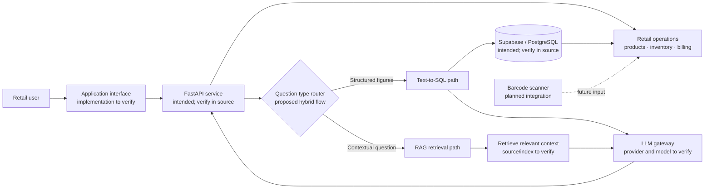

# 🛍️ Retail Sales Intelligence Platform

### AI-Powered Analytics · Natural-Language Business Queries · Barcode-Ready Billing

> **Project documentation status:** The project source repository was not present in the supplied workspace when this README was prepared. Product scope below is based on the project brief and its referenced conversation; implementation details, dependency versions, setup commands, and test results have not been verified against source code.


---

## 📚 Table of Contents

- [Overview](#-overview)
- [Project Status and Evidence](#-project-status-and-evidence)
- [Feature Snapshot](#-feature-snapshot)
- [Architecture](#-architecture)
- [Technology Stack](#-technology-stack)
- [Repository Structure](#-repository-structure)
- [Prerequisites](#-prerequisites)
- [Installation and Configuration](#-installation-and-configuration)
- [Running Locally](#-running-locally)
- [Tests](#-tests)
- [Example Business Questions](#-example-business-questions)
- [Limitations](#-limitations)
- [Roadmap](#-roadmap)
- [Contributing](#-contributing)
- [License](#-license)

## 🌟 Overview

The **Retail Sales Intelligence Platform** is intended to bring day-to-day retail operations and conversational business analytics into one system. Its stated scope includes product and inventory data, sales and billing records, and a natural-language interface for asking questions about business performance.

The project brief describes a hybrid AI approach: use **Text-to-SQL** for questions that need structured, numerical answers from operational data, and **Retrieval-Augmented Generation (RAG)** for questions that need contextual information. An LLM gateway is part of the proposed design, but its provider, model, and implementation are not confirmed here.

Barcode-based billing is part of the product direction. A physical scanner or camera-based scanner integration is **planned and unverified**, and should not be treated as available until implemented and documented in the codebase.

## 🧭 Project Status and Evidence

This README was created without access to the application source, dependency manifests, database migrations, or configuration files. The names **FastAPI**, **Supabase/PostgreSQL**, **hybrid Text-to-SQL + RAG routing**, and **LLM gateway** come from the requested project description and conversation context; they are therefore described as intended architecture, not confirmed implementation.

Before publishing this README as a final implementation guide, confirm each item against the repository:

| Area | Current documentation treatment |
|---|---|
| FastAPI service | Named in project context; source implementation not inspected |
| Supabase / PostgreSQL | Named in project context; schema and connection method not inspected |
| Text-to-SQL and RAG | Described as intended hybrid query design; routing and retrieval code not inspected |
| LLM gateway | Mentioned in project context; endpoint, provider, models, and fallback behavior not verified |
| Barcode scanner | Planned integration; hardware and scanner workflow not verified |
| Setup, tests, and results | No repository commands or test outcomes available to confirm |

## ✨ Feature Snapshot

| 🧩 Capability | Intended value | Status in this README |
|---|---|---|
| Retail data management | Organize product, inventory, supplier, purchase, and sales information | Project scope; implementation not verified |
| Billing and sales records | Record transactions and bill items for operational reporting | Project scope; implementation not verified |
| Conversational analytics | Ask questions about revenue, sales volume, products, and stock | Proposed capability; implementation not verified |
| Text-to-SQL | Translate structured business questions into database queries | Proposed capability; implementation not verified |
| RAG | Retrieve relevant context to support explanatory answers | Proposed capability; implementation not verified |
| Barcode-based billing | Scan a product code to identify an item during checkout | **Planned**; scanner integration not verified |

## 🏗️ Architecture

The diagram shows the **intended flow described in the project brief**. It is not a verified map of the current application. The physical barcode-scanner step is explicitly shown as planned.



### 🔄 Query workflow (proposed)

1. A user submits a business question through the application.
2. The service determines whether it needs structured database values or contextual retrieval.
3. Structured questions follow a Text-to-SQL path; contextual questions follow a RAG path.
4. The proposed LLM gateway supports interpretation and answer composition.
5. The answer is returned to the user. Exact safeguards, routing rules, and execution behavior must be confirmed from the implementation.

## 🧰 Technology Stack

| Layer | Technology in project context | Verification |
|---|---|---|
| API | FastAPI | Intended; source not available to inspect |
| Relational data | Supabase / PostgreSQL | Intended; schema and client library not available to inspect |
| Query analytics | Text-to-SQL | Proposed technique; implementation not verified |
| Contextual answers | RAG | Proposed technique; retrieval and embedding choices not verified |
| Language-model access | LLM gateway | Proposed component; provider and exact model intentionally unspecified |
| Barcode input | Barcode scanner integration | Planned; not confirmed as implemented |

No exact model names, versions, frontend framework, embedding model, or vector store are claimed because none could be confirmed from source files.

## 🗂️ Repository Structure

The source repository was not available in this workspace, so a real directory tree cannot be documented yet. Replace this section with the actual structure once the project files are available. Do not assume the example paths below exist.

```text
<repository-root>/
├── <application source directories — confirm>
├── <database schema or migrations — confirm>
├── <tests — confirm>
├── <dependency manifest — confirm>
├── <environment example file — confirm>
└── README.md
```

## ✅ Prerequisites

Confirm the project's supported versions from its dependency and deployment files. The following are likely requirements based on the named architecture, but are **not verified**:

- Python, if the API is implemented with FastAPI.
- Access to the configured Supabase project or PostgreSQL database, if used by the application.
- Credentials for the configured LLM gateway, if the AI routes call an external provider.
- Git, if cloning the source repository.

## 📦 Installation and Configuration

The actual repository URL, dependency manager, manifest, database schema, and required configuration keys were not supplied. Use the project’s own files as the source of truth; the commands below are placeholders, not confirmed working instructions.

```bash
# 1. Clone the repository (replace with its real URL)
git clone <repository-url>
cd <repository-directory>

# 2. Create and activate a virtual environment (if this is a Python project)
python -m venv .venv
# macOS / Linux:
source .venv/bin/activate
# Windows PowerShell:
# .\.venv\Scripts\Activate.ps1

# 3. Install dependencies using the manifest actually present in the repository
# Example only — use the project's documented command:
python -m pip install -r <requirements-file>
```

### 🔐 Environment variables

No environment-variable names could be verified. Check the application settings and provide values through a local, untracked environment file or your deployment secret manager. **Never commit real credentials.** The following names are illustrative placeholders only; replace them with the names the code actually reads:

```dotenv
# Illustrative placeholders — not verified application settings
SUPABASE_URL=<your-supabase-project-url>
SUPABASE_KEY=<your-supabase-key>
DATABASE_URL=<your-postgresql-connection-string>
LLM_GATEWAY_URL=<your-llm-gateway-endpoint>
LLM_GATEWAY_API_KEY=<your-llm-gateway-key>
```

Use only the database connection variable and credential type required by the actual project. Do not store service-role keys or provider secrets in client-side code.

## ▶️ Running Locally

The application entry point and startup command are unknown because no source files or project instructions were available. Once confirmed, document the exact command here. For a FastAPI application, a command might resemble the following, but the module path and options must match the code:

```bash
uvicorn <python_module>:<fastapi_app_object> --reload
```

The endpoint below is also a convention, not a verified URL: if the application uses FastAPI's default documentation route, its interactive API docs are commonly served at `http://127.0.0.1:8000/docs`.

## 🧪 Tests

No test suite or test command was present to inspect, so no test pass claim is made. When the repository is available, document its actual test runner and run the project's checks. For example, only if pytest is configured:

```bash
python -m pytest
```

## 💬 Example Business Questions

These are examples of questions the proposed analytics experience could support; they are **not verified as working prompts**:

- “What is the total revenue for this month?”
- “Which products sold the most units?”
- “How many products are below their reorder threshold?”
- “What is the average bill value?”
- “How are sales distributed by payment mode?”

The available answers depend on the implemented schema, business definitions, and records in the connected database.

## 🤝 Contributing

Contributions are welcome once the project’s contribution process is established. For now, open an issue to discuss a proposed change, keep credentials out of commits, and include relevant tests with code changes where a test suite exists. Add a `CONTRIBUTING.md` with the project's preferred workflow when one is defined.

## 📄 License

No license file or license terms were available to inspect. Until the project owner adds a license, reuse and redistribution permissions are not specified. Add a `LICENSE` file and update this section with the chosen license before inviting external contributions.
